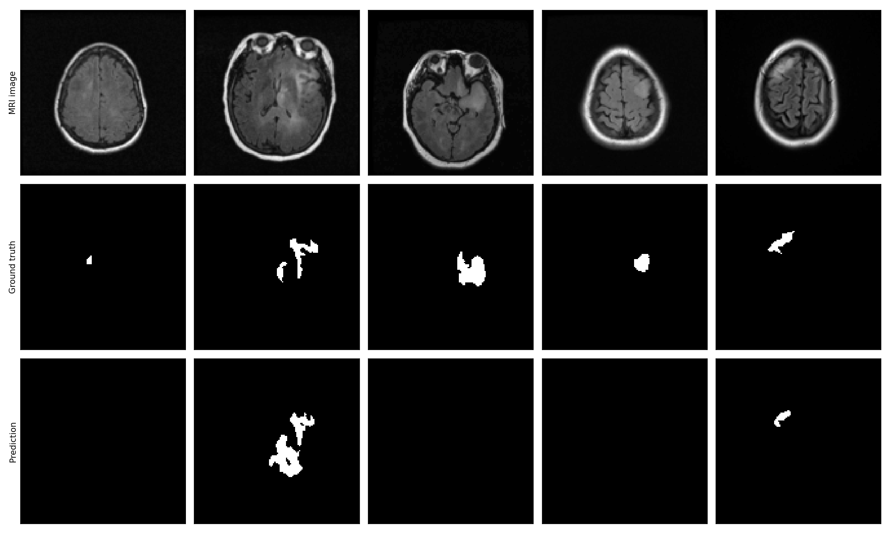

# Brain Tumour Segmentation with U-Net (PyTorch)

Computer Vision course project. A small U-Net takes a brain MRI slice and predicts a binary mask: tumour vs. not tumour.

## Files

| File | Purpose |
|---|---|
| `brain_tumour_unet.py` | Loads the data, builds the U-Net, trains it, evaluates on the test set, saves the figure and the model |
| `demo.py` | Loads `segmenter.pt` and shows the MRI, the predicted mask and a red overlay for one slice |
| `segmenter.pt` | Trained weights, plus the list of test-slice paths used by the demo |
| `results.png` | Figure with 5 test slices: MRI, ground-truth mask, predicted mask |
| `training_log.txt` | Console output of the training run reported below |
| `data/` | The LGG MRI Segmentation dataset (not part of the code) |

## Setup

```
pip install torch numpy pillow matplotlib
```

The dataset is `mateuszbuda/lgg-mri-segmentation` from Kaggle, unzipped into `data/`. The code finds every `*_mask.tif` under `data/` and pairs it with its image automatically.

## Running

```
python brain_tumour_unet.py          # train, evaluate, save results.png and segmenter.pt
python demo.py                       # demo on a random test slice
python demo.py path/to/slice.tif     # demo on a slice you choose
```

Training uses the Mac GPU (`mps`) if available, then CUDA, then the CPU.

The demo works on any computer, wherever the project folder is placed:
- Train once with `python brain_tumour_unet.py`. This creates a `segmenter.pt` for your machine, and `python demo.py` then works straight away.
- The `segmenter.pt` in this repository is already trained, so you can skip training. Download the dataset into `data/` and run `python demo.py`.
- With no dataset, give the demo any MRI slice: `python demo.py path/to/slice.tif`.
- `segmenter.pt` stores the test slices as `patient_folder/slice.tif`. The demo looks for them inside `data/`, however the dataset was unzipped.

## Method

**Data.** The dataset has 3,929 slices from 110 patients (`.tif`, 256x256, 3 channels: pre-contrast, FLAIR, post-contrast), each with a mask file. Everything is resized to 128x128 (bilinear for images, nearest-neighbour for masks) and images are scaled to 0-1.

**Subset and split.**
- Patients are split first (80% train / 20% test, fixed random seed), so slices from one patient are never in both sets: 88 train patients, 22 test patients.
- Slices are then sampled inside each side, mostly with tumour and some without:
  - train: 240 tumour + 80 empty = 320 slices
  - test: 60 tumour + 20 empty = 80 slices

**Model.** U-Net with three down levels and a bottleneck, using channels 32-64-128-256.
- Each block is Conv3x3 + BatchNorm + ReLU, twice.
- The encoder downsamples with max-pooling. The decoder upsamples with `ConvTranspose2d` and joins the encoder features through skip connections with `torch.cat`.
- A 1x1 convolution with a sigmoid gives one output channel: the tumour probability per pixel.

**Loss.** Binary cross-entropy + soft Dice loss. Tumours cover a tiny part of the image, so BCE alone would let the model predict "no tumour" everywhere. Dice loss penalises that directly.

**Training.** Adam, learning rate 1e-3, batch size 16, 35 epochs. The training loss is printed every epoch.

**Evaluation.** The probability map is thresholded at 0.5. Dice and IoU for the tumour class are computed over all test pixels pooled together. Per-slice Dice is undefined on slices with no tumour, so pooling avoids that. Pixel accuracy is deliberately not reported: predicting "no tumour" everywhere already scores about 98% on this data.

## Results

Test set: 80 slices from 22 patients that were never seen in training.

| Metric (tumour class) | Value |
|---|---|
| Dice | **0.7757** |
| IoU | **0.6336** |

Training loss (BCE + Dice) fell from 1.517 at epoch 1 to 0.178 at epoch 35. It dropped quickly until about epoch 20, then flattened and jittered between 0.18 and 0.25. The full per-epoch log is in `training_log.txt`.



The figure shows the first 5 test slices that contain a tumour (the MRI is displayed from the FLAIR channel). The model is not uniformly good:
- Slice 2: the tumour is found, but the prediction adds an extra region.
- Slice 5: the tumour is found, but the predicted region is smaller than the ground truth.
- Slices 1, 3 and 4: the tumour is missed and the predicted mask is empty. Slice 1 is a very small tumour.

## Limitations

- **Small experiment.** The test set is 80 slices and the model was trained once with one random seed, so the Dice of 0.78 would move if the patient split or seed changed.
- **No validation set.** The 35-epoch count was fixed in advance, and the test set was not used to choose anything. The test score comes from the final epoch, not the best epoch.
- **Pooled metric.** Pooled Dice and IoU weight large tumours more than small ones, and the small tumours are where this model fails most.
- **No augmentation.** Training used only 320 slices with no flips, rotations or intensity changes. This is a likely cause of the missed tumours and the jittery loss.
- **Only 128x128 input.** Downscaling from 256x256 removes detail, which hurts the smallest tumours.
